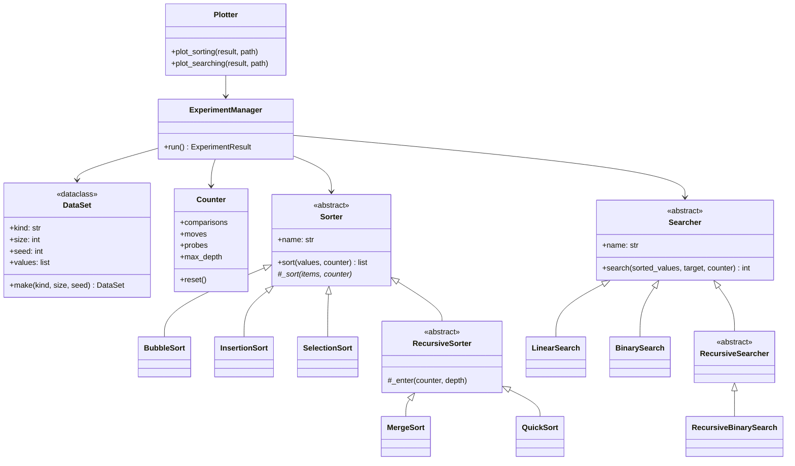

# Design: sorting_and_searching

A small, public codebase that does two jobs at once:

1. **Measure** how sorting and searching algorithms behave as the input grows, and show that the measurements match Big O predictions.
2. **Demonstrate good code**: well-formed classes, clean inheritance, readable names, one clear design.

It is a display piece. The code is built to be read, so every choice below favors clarity over cleverness.

## What it counts (and why not time)

Algorithms report **operations**, not seconds. A `Counter` object is passed into every algorithm and records:

| field         | meaning                                          |
|---------------|--------------------------------------------------|
| `comparisons` | times two values were compared                   |
| `moves`       | times a value was written to a new position (a swap counts as 2 moves) |
| `probes`      | times a search looked at one element             |
| `max_depth`   | deepest recursion reached (0 for non-recursive)  |

Counts are exact and repeatable. Timings are noisy and depend on the machine, so they are not used for any claim. Data is generated from fixed seeds, so every run of the experiment gives the same numbers.

No global variables. State lives in objects that are passed in.

## Class map



### The rules each class follows

- **`DataSet`**: a `dataclass`. Builds `random`, `sorted` and `reversed` lists from a seed. Knows nothing about algorithms.
- **`Counter`**: a plain class with counters and `reset()`. Knows nothing about algorithms either.
- **`Sorter`** (abstract): the public method `sort(values, counter)` **copies** the input, calls the subclass's `_sort`, checks the result is sorted, and returns it. The input list is never changed. This is the *template method* pattern: the base class owns the steps that must always happen, the child owns only the algorithm.
- **`BubbleSort`, `InsertionSort`, `SelectionSort`**: one file and one class each. They differ only in `_sort`.
- **`RecursiveSorter`** (abstract, child of `Sorter`): adds recursion-depth tracking via `_enter(counter, depth)`. `MergeSort` and `QuickSort` inherit from it, so they are children of a child.
  - `QuickSort` uses the **first element as the pivot** on purpose, so sorted input is its worst case and the n² curve is visible. A docstring says so.
- **`Searcher`** (abstract): `search(sorted_values, target, counter)` returns the index, or `-1`. Same shape as `Sorter`.
- **`LinearSearch`, `BinarySearch`**: the iterative pair.
- **`RecursiveSearcher`** (abstract, child of `Searcher`), with **`RecursiveBinarySearch`** as its child. It must return the same index as `BinarySearch` for every input, and a test checks that.
- **`ExperimentManager`**: the only class that knows the whole system. It is given a list of sorters, a list of searchers, sizes, kinds and a seed count, and returns an `ExperimentResult` (a dataclass of rows). It never draws or writes files.
- **`Plotter`**: takes an `ExperimentResult` and writes PNGs. It never runs experiments.

Dependencies point one way: `Plotter` and `ExperimentManager` use the algorithm classes; the algorithm classes use only `Counter`.

## Folder layout

```
sorting_and_searching/
  README.md             what this is, in 10 lines, with links
  DESIGN.md             this file
  PROVENANCE.md         what code or ideas came from where
  BIG_O.md              Big O explained, and how our graphs match it
  prompts/              every prompt Flo sent Anna, in order (see prompts/README.md)
  reports/              Anna's report for each prompt
  src/sortsearch/
    __init__.py
    counter.py
    dataset.py
    sorters/   base.py bubble.py insertion.py selection.py recursive.py merge.py quick.py
    searchers/ base.py linear.py binary.py recursive_binary.py
    manager.py
    plotter.py
  tests/                one test file per module
  scripts/run_experiment.py     runs everything, writes results and plots
  docs/                 the public home page (GitHub Pages serves this folder)
    index.html
    plots/
    report.pdf          the LaTeX version, linked from the home page
  pyproject.toml
```

Python 3.9 or newer. No third-party packages except `matplotlib` (plots) and `pytest` (tests).

## Expectations: what the graphs should show

Sizes: 10, 20, 40, 80, 160, 320, 640 (largest stays under Python's default recursion limit of 1000, even for quicksort's worst case).

| algorithm      | random input | sorted input | reversed input |
|----------------|--------------|--------------|----------------|
| bubble (full)  | n²           | n²           | n²             |
| insertion      | n²           | n            | n²             |
| selection      | n²           | n²           | n²             |
| merge sort     | n log n      | n log n      | n log n        |
| quick sort     | n log n      | **n²**       | **n²**         |

| search           | cost per lookup |
|------------------|-----------------|
| linear           | about n/2 for hits, n for misses |
| binary (both)    | log n           |

For each curve, the plot overlays the predicted shape scaled by one constant (fit by least squares at the measured sizes). The picture is: measured dots, a prediction line through them, and a visible miss where theory and practice differ. `BIG_O.md` explains each match and each mismatch in plain language.

## Home page

`docs/index.html`, served by GitHub Pages from `/docs`. It shows, in order: what this is; the class diagram; the comparison plots; the Big O explanation; a short "read the code" tour with links into `src/`; and a link to the LaTeX report. Static HTML and CSS only, no build step, readable on a phone.

## The second lesson: how one agent prompts another

This repo's `prompts/` folder is part of the display. Flo (the Foreman) wrote each prompt to Anna (the builder) before she built each piece, and Anna's `reports/` entry says what she did. A reader can follow the build from the first prompt to the finished site. Each prompt states **why** the work matters, the **constraints**, and a **falsifiable acceptance test**, because an agent can't ask a hallway question.

## Build order (each step is its own prompt, its own branch, its own report)

1. Core: `Counter`, `DataSet`, all `Sorter` and `Searcher` classes, tests.
2. Manager and experiment script; results to CSV.
3. Plotter; Big O overlay curves; `BIG_O.md`.
4. Home page and LaTeX report.
5. Read-through for clarity: names, docstrings, dead code.

Flo reviews each branch and merges it. Nothing is pushed straight to `main` by the builder.
